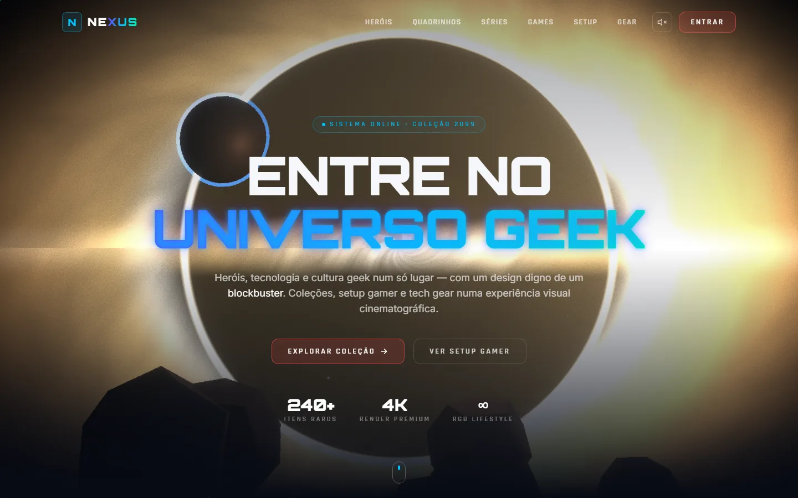
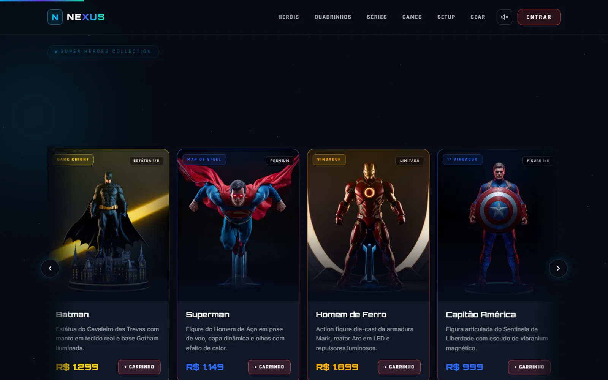

[English](README.md) | **Português**

# NEXUS — Vitrine Geek Premium

> **Tipo:** conceito / fan-made — vitrine de portfólio, sem fins comerciais, **sem afiliação** com Marvel, DC, The Boys ou demais marcas citadas · **Demo:** https://nexus-geek-store.vercel.app



Loja geek **conceitual e cinematográfica** focada em **impacto visual**. Sem backend, sem checkout real — é uma **vitrine interativa** estilo *Apple + Cyberpunk + Gaming Store*.

> Tema: personagens de HQ e séries, PC Master Race / setup gamer e tech gear. Preços e produtos são ilustrativos; não há venda real.

---

## ✨ Destaques visuais

- **Hero "buraco negro" cinematográfico (React Three Fiber)** — estilo *Interestelar/Gargantua*: disco de acreção **turbulento**, anel de fóton, **distorção gravitacional** (lente de Einstein via *postprocessing* custom), **planeta** com atmosfera + **asteroides** instanciados, poeira espacial e iluminação **HDRI**.
- **Pós-processamento cinematográfico** (react-postprocessing): bloom, vinheta, aberração cromática e grão de filme.
- **Poeira cósmica de fundo** com parallax em profundidade — sem grades/HUD (visual de fotografia espacial, não de interface).
- **Cards 3D com tilt real** (parallax por mouse), glow dinâmico que segue o cursor e brilho holográfico.
- **Imagens nos cards** de heróis e capas de quadrinho (geradas por IA), com *fallback* automático pra arte vetorial.
- **Scroll cinematográfico** com GSAP ScrollTrigger + reveals com Framer Motion.
- **Microinterações**: botões com brilho/expansão, números que contam ao entrar na tela, logo com pulso.
- **Som de UI procedural** (WebAudio, sem assets) — botão liga/desliga na navbar.
- **Dark mode neon/RGB**, mobile-first e responsivo. **Easter egg Konami** escondido na página (o "cupom secreto" exibido é só uma brincadeira, não há checkout).



## 🧱 Estrutura

```
src/
├─ App.jsx                  # layout, scroll progress, cursor glow
├─ main.jsx                 # bootstrap do React
├─ index.css                # estilos base + utilitários Tailwind
├─ hooks/useSound.js        # bips de UI via WebAudio
├─ data/products.js         # catálogo placeholder
├─ theatre.js               # timeline do hero (Theatre.js) + theatre-state.json
└─ components/
   ├─ ParticleBackground.jsx  # poeira cósmica (parallax em profundidade)
   ├─ BlackHoleScene.jsx      # hero R3F: buraco negro + disco + lente grav. + planeta + asteroides + HDRI
   ├─ Navbar.jsx              # nav fixa + menu mobile + toggle som
   ├─ Hero.jsx                # landing cinematográfica
   ├─ HeroVisual.jsx          # arte vetorial dos heróis no hero
   ├─ HeroesCollection.jsx    # "Super Heroes Collection"
   ├─ ComicsSection.jsx       # seção de quadrinhos
   ├─ SeriesSection.jsx       # seção de séries
   ├─ GamesSection.jsx        # seção de games (com filtros)
   ├─ GamingSetup.jsx         # "Gaming Setup & PC Master Race"
   ├─ TechGear.jsx            # "Tech Gear / Accessories"
   ├─ Section.jsx             # SectionHeading (GSAP) + Marquee
   ├─ ProductCard.jsx         # card tilt 3D + foto real (fallback vetorial)
   ├─ ComicCard.jsx           # capa real (fallback pop-art vetorial)
   ├─ SeriesCard.jsx          # card de série
   ├─ ScrollRow.jsx           # carrossel horizontal
   ├─ KonamiEgg.jsx           # easter egg Konami
   └─ Footer.jsx
```

## 🚀 Rodando localmente

Pré-requisitos: **Node.js 18+** e **npm**.

```bash
npm ci
npm run dev      # http://localhost:5173
npm run build    # gera /dist
npm run preview  # serve o build
```

Stack: **Vite 5 + React 18 · Three.js · React Three Fiber + drei · react-postprocessing · Theatre.js · GSAP (ScrollTrigger) · Framer Motion · Tailwind CSS 3 · shaders GLSL**.

Não há variáveis de ambiente, testes automatizados nem linter configurados; a verificação disponível é `npm run build`.

## 🛒 Catálogo

- **Setup & Gear**: produtos com modelos e preços de mercado BR (ilustrativos) e **fotos reais** em `public/img/` — teclado mecânico, mouse, headset, monitor, gabinete RGB, microfone de stream, mousepad XXL e cadeira gamer.
- **Heróis e Quadrinhos**: aceitam **imagem real** (`public/heroes/<nome>.jpg|png` e `public/comics/<nome>.jpg|png`); se o arquivo não existir, o card cai automaticamente na **arte vetorial** (sem imagem quebrada). Veja os `LEIA-ME.txt` nessas pastas para os nomes esperados.

Para trocar um produto, edite `src/data/products.js`: ajuste `name`, `price`, `spec`, `blurb`, as cores `accent`/`accent2` e o caminho `image`/`cover` (omita para usar a arte procedural/vetorial).

## 📦 Build & deploy

O projeto é 100% estático. `npm run build` gera a pasta `dist/`, que pode ser publicada em qualquer host estático (Vercel, Netlify, GitHub Pages, Cloudflare Pages, etc.).

## ⚠️ Limitações

- Sem backend, login, carrinho ou checkout reais — botões como "Entrar" e "Carrinho" são apenas visuais.
- A cena 3D é pesada (chunk de ~1 MB); em GPUs fracas o desempenho pode cair.

## 🎨 Créditos e direitos

Projeto conceitual **fan-made**, para fins de portfólio/estudo, sem venda real e **sem afiliação, patrocínio ou endosso** de qualquer titular de marca.

- O catálogo (`src/data/products.js`) cita personagens da DC, Marvel e The Boys e produtos de marcas como Logitech, Razer, HyperX, Samsung e Keychron. Esses nomes são marcas de terceiros e aparecem só como exemplo de vitrine.
- As imagens de heróis e capas em `public/heroes` e `public/comics` foram criadas com geradores de imagem por IA e representam personagens protegidos por direitos de terceiros. Para uso comercial, substitua por material licenciado.
- Fotos de produtos e cenários em `public/img/`: origem não documentada.
- HDRI de iluminação em `public/hdri/`: **Poly Haven** (`dikhololo_night`), licença **CC0** (domínio público).

## 🔒 Segurança

Veja [SECURITY.md](SECURITY.md).

## 📄 Licença

Ainda não há licença definida; todos os direitos reservados ao autor. Personagens, nomes e marcas de terceiros pertencem aos respectivos titulares.
